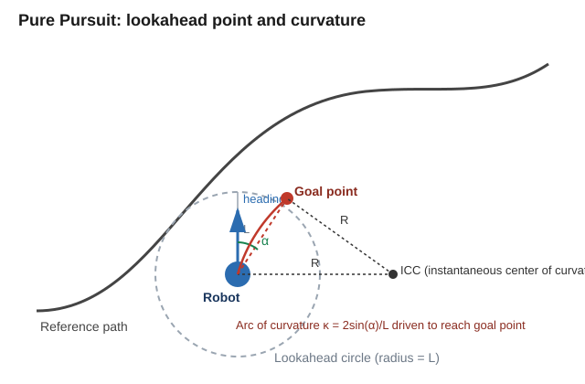

# Pure Pursuit

A MATLAB demo simulating the **pure pursuit** path-tracking algorithm controlling a 2D differential-drive robot through a series of goal points.

📖 For a detailed, step-by-step explanation of the algorithm and its derivation, see **[docs/PurePursuitAlgorithm.md](docs/PurePursuitAlgorithm.md)**.

## Repository Contents

| File | Description |
|---|---|
| [`SIMULATION_PurePursuit.m`](SIMULATION_PurePursuit.m) | Entry point. Runs the simulation loop and renders the result. |
| [`purePursuit.m`](purePursuit.m) | Pure pursuit controller: computes the goal point, cross-track error, and resulting angular velocity. |
| [`differentialDriveKinematics.m`](differentialDriveKinematics.m) | Kinematic model (`'simple'` or `'icr'`) used to propagate the robot's pose given `(v, ω)`. |
| [`drawRobot.m`](drawRobot.m) | Draws the robot (body + heading) for visualization. |

## How to Run

1. Clone this repository.
2. Open the repository folder in MATLAB.
3. Open `SIMULATION_PurePursuit.m` and click **Run**.

This starts a simulation of a differential-drive robot driving through a predefined list of goal points (`goalPoints`), using the pure pursuit algorithm to steer toward each one in turn. The robot advances to the next goal point once it comes within tolerance of the current one.

## Robot Motion Controllers

Pure pursuit is an example of a **geometric path-tracking controller** — a lateral controller that steers using only vehicle kinematics and the reference path geometry, assuming no wheel slip. See [docs/PurePursuitAlgorithm.md](docs/PurePursuitAlgorithm.md) for the full explanation, including:

- How the lookahead goal point is found
- Derivation of the curvature control law `κ = 2 sin(α) / L`
- How curvature maps to angular velocity
- Cross-track error via orthogonal projection
- Tuning the lookahead distance

## References

- [Geometric Lateral Control: Pure Pursuit — Coursera, Intro to Self-Driving Cars](https://www.coursera.org/lecture/intro-self-driving-cars/lesson-2-geometric-lateral-control-pure-pursuit-44N7x)
- [Orthogonal Projection Onto a Line — Wikibooks](https://en.wikibooks.org/wiki/Linear_Algebra/Orthogonal_Projection_Onto_a_Line)