# The Pure Pursuit Algorithm

Pure pursuit is a **geometric path-tracking controller**: a lateral (steering) controller that drives a vehicle along a reference path using only the geometry of the path and the vehicle's current pose, not vehicle dynamics or tire forces. It assumes the no-slip condition holds (the wheels roll without skidding), which makes it simple to implement and a popular first controller for mobile robots, including the differential-drive robot simulated in this repository.

This page explains the algorithm conceptually, derives the key control law, and relates it back to the code in [`purePursuit.m`](../purePursuit.m).

## Contents
- [1. Geometric path tracking](#1-geometric-path-tracking)
- [2. The core idea](#2-the-core-idea)
- [3. Finding the goal point](#3-finding-the-goal-point)
- [4. Deriving the curvature control law](#4-deriving-the-curvature-control-law)
- [5. From curvature to angular velocity](#5-from-curvature-to-angular-velocity)
- [6. Cross-track error](#6-cross-track-error)
- [7. Choosing the lookahead distance](#7-choosing-the-lookahead-distance)
- [8. Algorithm summary](#8-algorithm-summary)
- [9. References](#9-references)

## 1. Geometric path tracking

A **geometric path tracking controller** computes steering commands using only the vehicle's kinematics (position and heading) and the shape of the reference path. It ignores forces such as tire slip, inertia, and friction. This is in contrast to dynamic controllers (e.g. LQR or MPC with a vehicle dynamics model), which account for those forces explicitly.

Pure pursuit is the most common example of a geometric lateral controller. Its only tuning parameter is the **lookahead distance**, `L` — how far ahead on the path the controller "looks" to pick its next target.

## 2. The core idea

At every control step, pure pursuit performs four steps:

1. Find the point on the reference path that is a distance `L` (the lookahead distance) away from the robot. This is the **goal point**.
2. Compute the angle `α` (alpha) between the robot's current heading and the straight line (chord) connecting the robot to the goal point.
3. Treat that chord as if it were a chord of a circular arc that is tangent to the robot's current heading. Solve for the radius `R` of that arc — this is the **instantaneous radius of curvature** the robot must drive along to pass through the goal point.
4. Convert that curvature into a steering/angular velocity command and drive it for one time step, then repeat.

Because the goal point is recomputed every step as the robot moves, the robot continually re-aims at a point `L` ahead of it, producing a smooth arc that converges onto the path — much like a driver glancing slightly ahead of the car and steering toward that spot rather than fixating on the exact point under the hood.

### Visual walkthrough of one control step

| | |
|---|---|
| 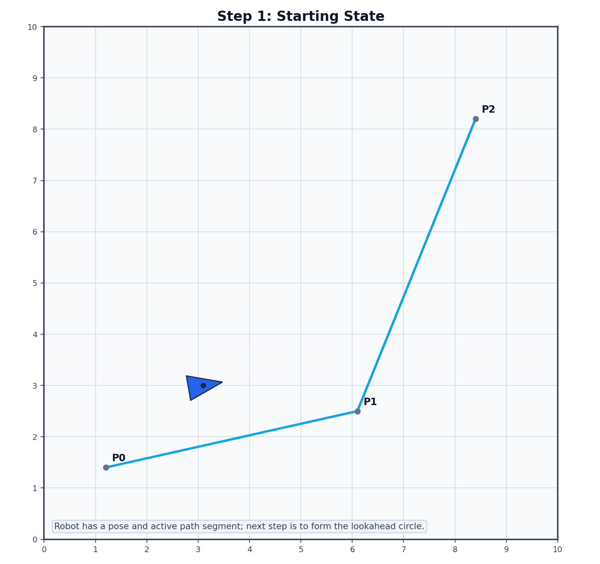 | 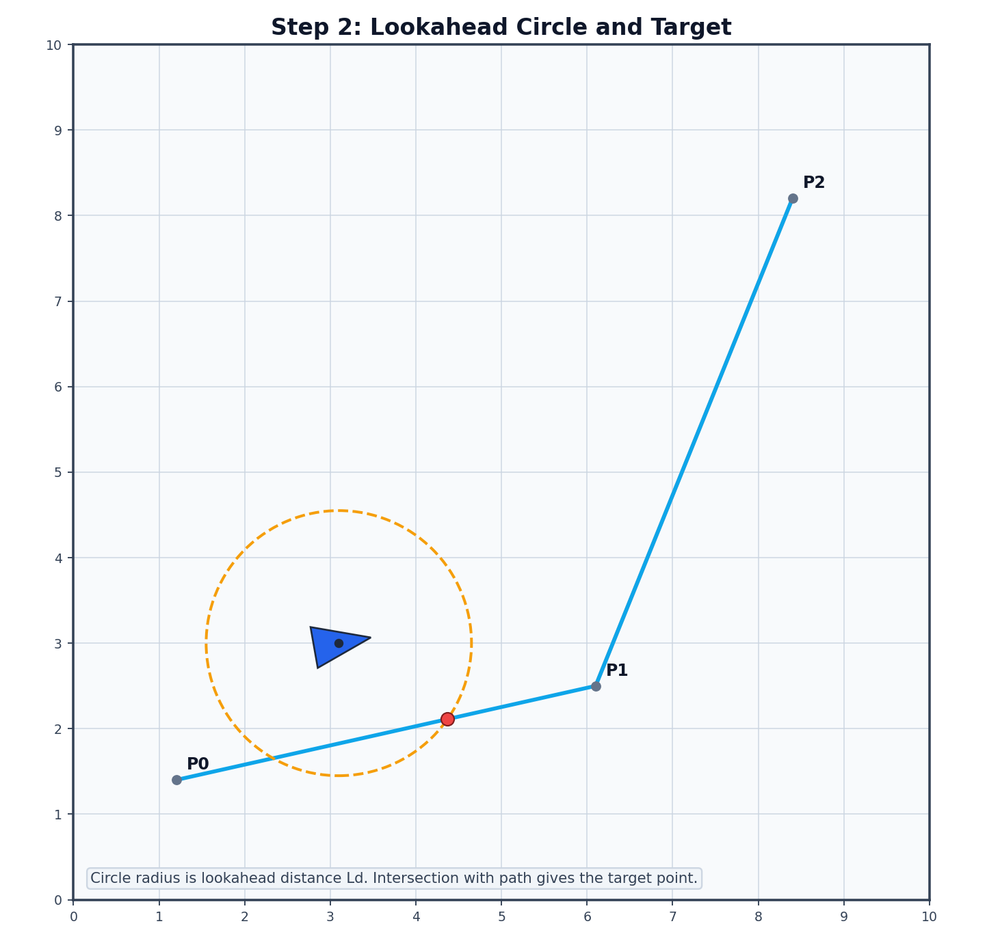 |
| **1. Starting state.** The robot has a pose and an active path segment. | **2. Lookahead circle and target.** A circle of radius `L` centered on the robot intersects the path segment at the goal point. |
| 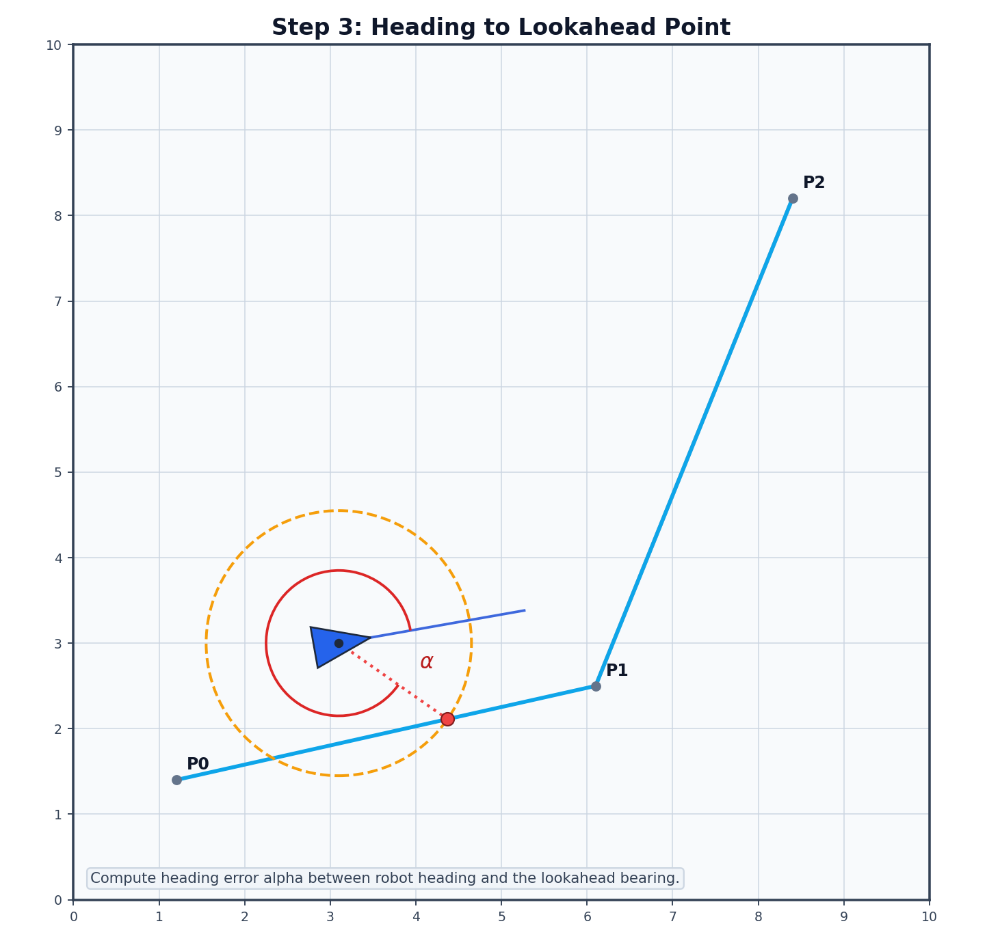 | 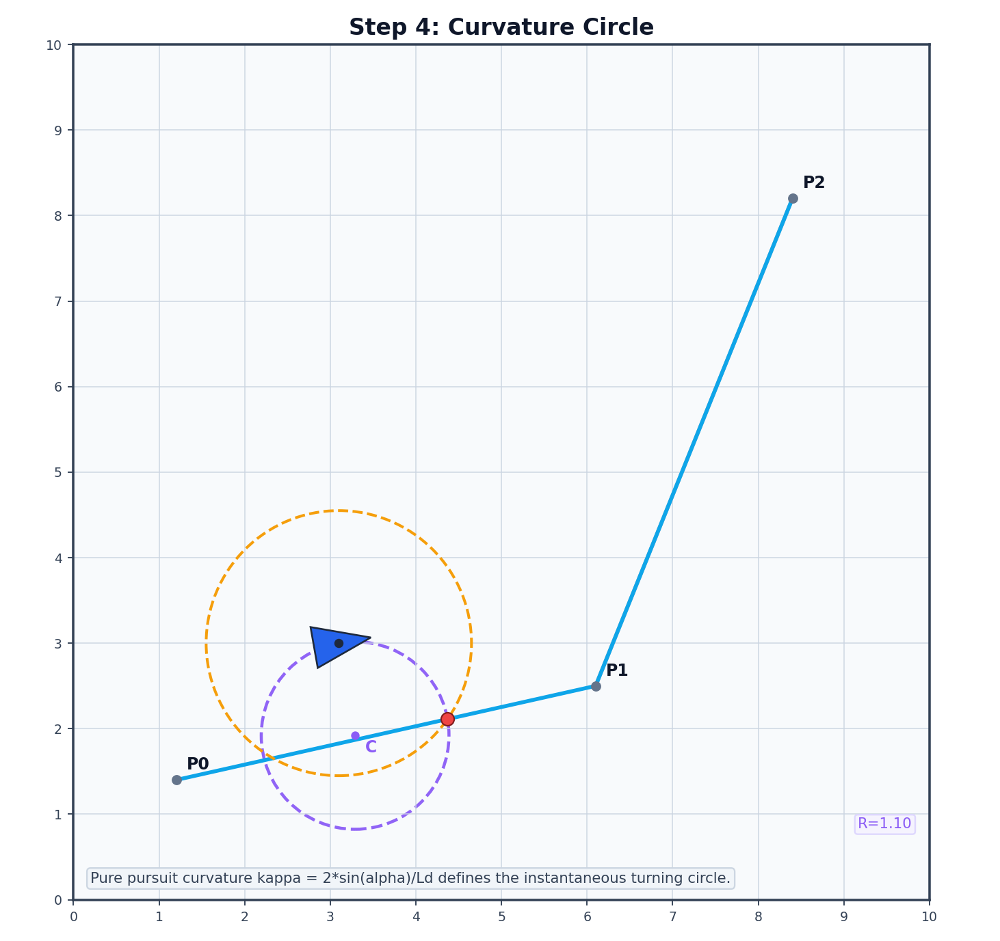 |
| **3. Heading to lookahead point.** The angle `α` is measured between the robot's heading and the bearing to the goal point. | **4. Curvature circle.** `κ = 2 sin(α) / L` defines the instantaneous turning circle (center `C`, radius `R`) that carries the robot through the goal point. |
| 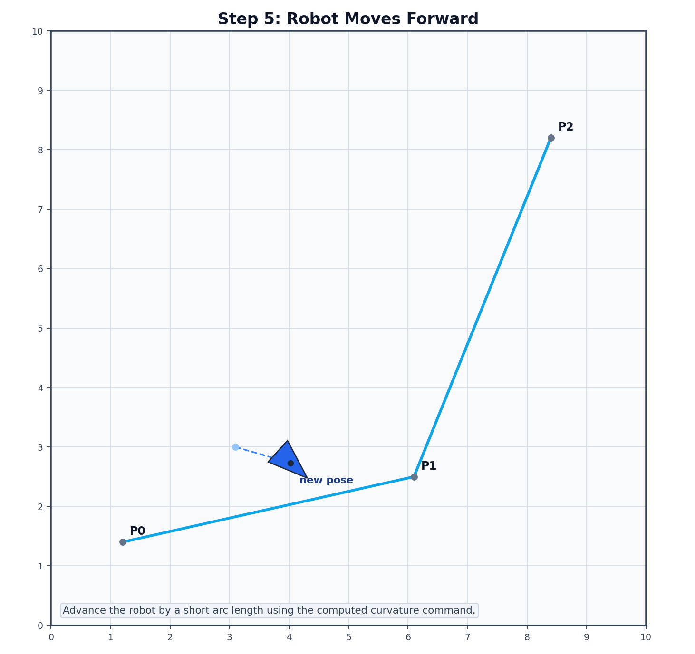 | 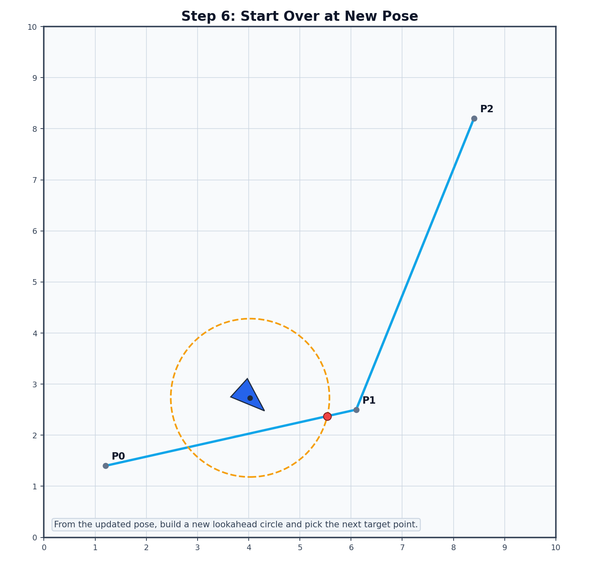 |
| **5. Robot moves forward.** The robot advances a short arc length along the commanded curvature. | **6. Start over at new pose.** From the new pose, a new lookahead circle and goal point are found, and the cycle repeats. |

Repeating this cycle every control step produces smooth motion along the whole path:

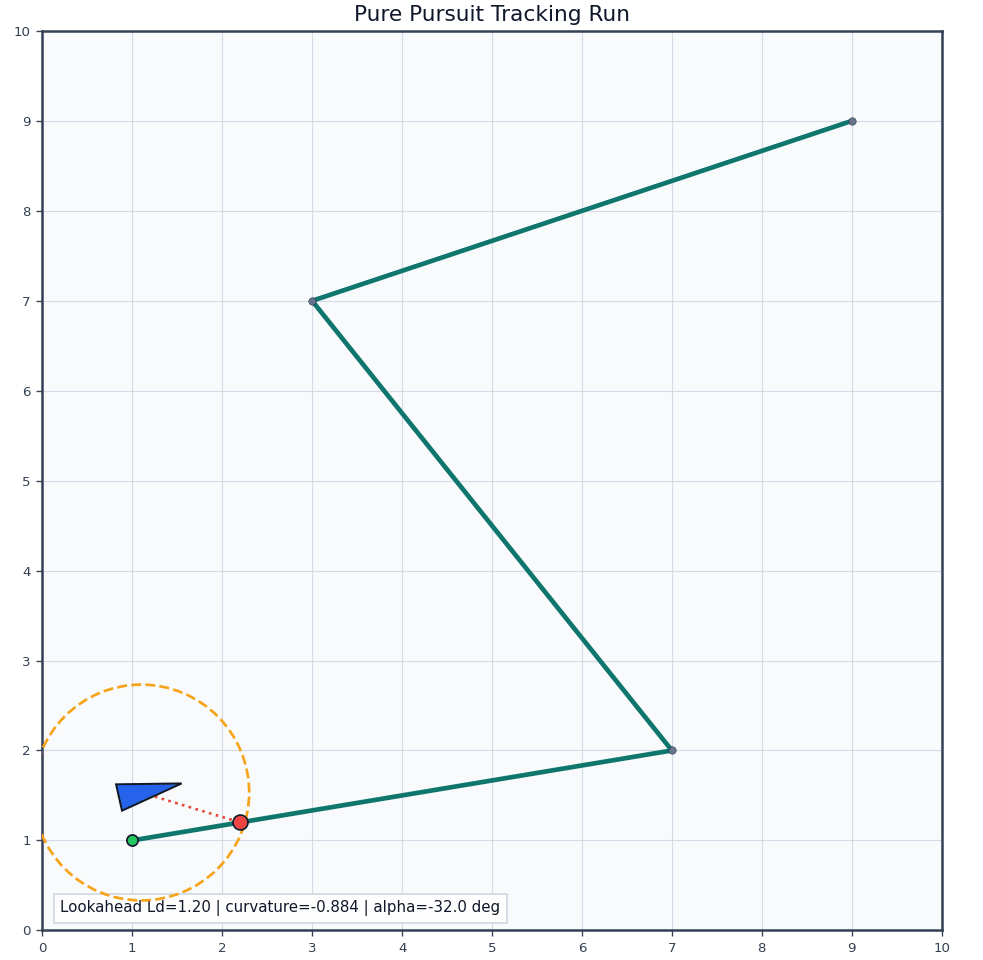

## 3. Finding the goal point

The reference path in this repo is represented as a sequence of straight line segments between goal points (see `goalPoints` in [`SIMULATION_PurePursuit.m`](../SIMULATION_PurePursuit.m)). For the current segment, the goal point is the intersection between:

- a circle of radius `L` centered on the robot, and
- the line segment from the last goal to the current goal.

This is solved in `getGoalPoint` inside [`purePursuit.m`](../purePursuit.m) using the standard circle/line-segment intersection approach (parameterize the segment as `s1 + t*d`, substitute into the circle equation, and solve the resulting quadratic `a*t^2 + b*t + c = 0` for `t` in `[0, 1]`):

```matlab
d = lineSegEndPoint - lineSegBeginPoint;
f = lineSegBeginPoint - currentPose(1:2);

a = dot(d,d);
b = 2*dot(f,d);
c = dot(f,f) - r*r;
discriminant = b*b - 4*a*c;
```

If two valid intersections exist, the one closer to the segment's end point is chosen so the robot keeps making forward progress along the path. If the robot is already within `L` of the segment's end point, that end point is used directly as the goal point instead, so the robot converges onto the final target rather than circling around it.

| | |
|---|---|
| 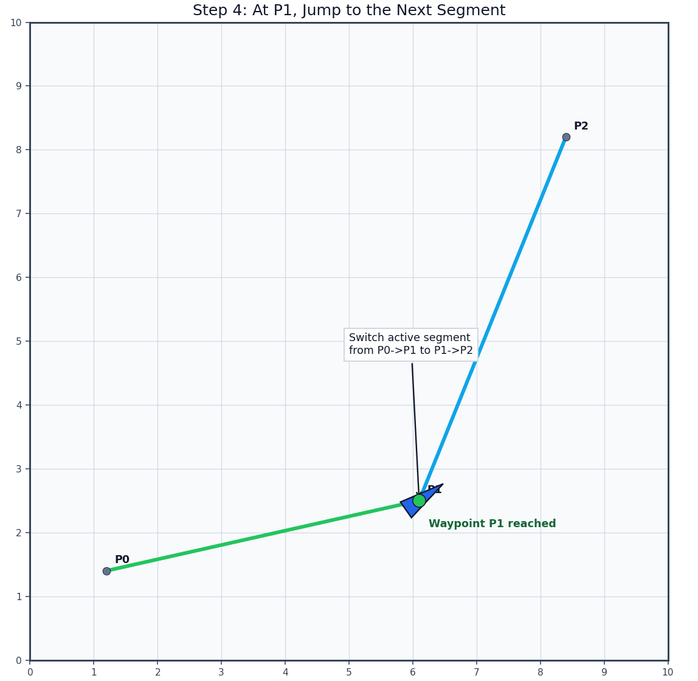 | 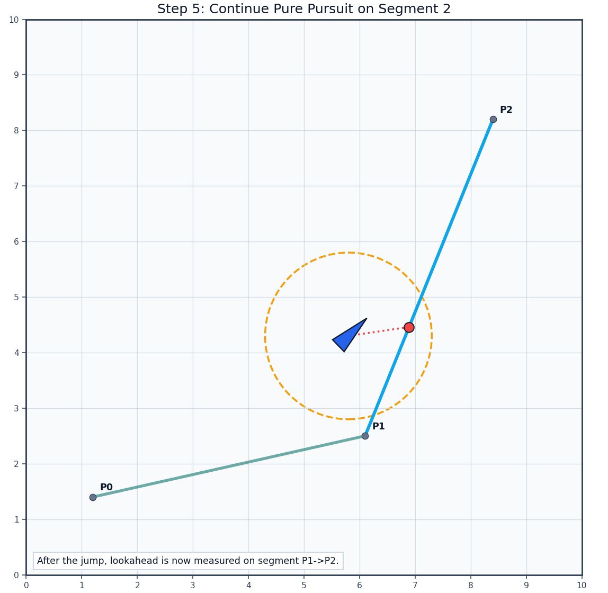 |
| **Reaching the waypoint.** Once the robot is within the goal tolerance of the current segment's end point, the active segment advances to the next pair of waypoints. | **Continuing on the new segment.** The lookahead search repeats against the new segment, and pure pursuit proceeds exactly as before. |

## 4. Deriving the curvature control law

Once the goal point is known, pure pursuit assumes the robot will follow a circular arc of radius `R` that:

- passes through the robot's current position,
- is tangent to the robot's current heading at that position, and
- passes through the goal point.

The center of that circle is the **instantaneous center of curvature (ICC)**, labeled `C` with radius `R` in step 4 of the [visual walkthrough above](#2-the-core-idea). Because the robot's position and the goal point both lie on the circle, and the chord between them has length `L`, the triangle formed by the ICC, the robot, and the goal point is **isosceles** (two sides of length `R`).

The angle between the robot's heading (tangent to the circle) and the chord to the goal point is `α`. By the tangent-chord angle relationship, the angle subtended by the chord at the circle's center is `2α`. Applying the law of sines to the isosceles triangle:

$$\frac{L}{\sin(2\alpha)} = \frac{R}{\sin(90^\circ - \alpha)}$$

Using $\sin(2\alpha) = 2\sin\alpha\cos\alpha$ and $\sin(90^\circ-\alpha) = \cos\alpha$, this simplifies to:

$$R = \frac{L}{2\sin\alpha}$$

Curvature `κ` is defined as the reciprocal of the radius, so:

$$\kappa = \frac{1}{R} = \frac{2\sin\alpha}{L}$$

This is exactly the control law computed in `purePursuit.m`:

```matlab
vec2goal = gp - currentPose(1:2);
alpha = (atan2(vec2goal(2), vec2goal(1)) - currentPose(3));
kappa = 2*sin(alpha)/lookaheadDist_m;
```

A larger `α` (goal point far off to one side) produces a larger curvature (tighter turn); `α = 0` (goal point directly ahead) produces zero curvature (drive straight).

## 5. From curvature to angular velocity

For a vehicle driving at linear speed `v` along an arc of curvature `κ`, the angular velocity needed to stay on that arc is simply:

$$\omega = \kappa \cdot v$$

which is the last line of `purePursuit.m`:

```matlab
w_radps = kappa * v_mps;
```

This `(v, ω)` command pair is then fed into the differential-drive kinematic model in [`differentialDriveKinematics.m`](../differentialDriveKinematics.m) to update the robot's pose for the next time step, using either the exact instantaneous-center-of-rotation (`'icr'`) model or the simplified linear (`'simple'`) model.

## 6. Cross-track error

Independent of the steering command, it's often useful to measure how far the robot currently is from the reference path — the **cross-track error**. This is computed by orthogonally projecting the robot's position onto the current path segment and measuring the distance to that projection:

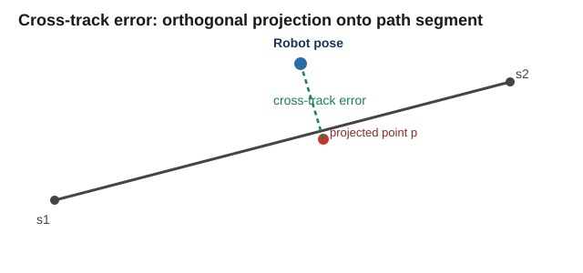

```matlab
function [projected_p] = projectOntoSegment(s1, s2, p1)
    s = s2 - s1;            % vector describing the segment
    p = p1 - s1;             % vector from segment start to the robot
    projected_p = (dot(p,s)/dot(s,s)) * s;  % scalar projection of p onto s
    projected_p = projected_p + s1;          % translate back to world frame
end
```

This value isn't used to steer the robot in this implementation (pure pursuit steers using the lookahead goal point instead), but it is useful for logging/plotting tracking performance, and is a building block for more advanced controllers that blend cross-track error with pure pursuit.

See also: [Orthogonal Projection Onto a Line (Wikibooks)](https://en.wikibooks.org/wiki/Linear_Algebra/Orthogonal_Projection_Onto_a_Line).

## 7. Choosing the lookahead distance

The lookahead distance `L` is the single tuning parameter of pure pursuit, and it trades off responsiveness against stability:

- **Small `L`** — the robot aims very close to itself, producing tight tracking of the path but a jerkier, more oscillatory response (it can overshoot and "hunt" back and forth across the path, especially at higher speeds).
- **Large `L`** — the robot aims far down the path, producing smoother, more stable motion but cutting corners on sharp curves (larger steady-state tracking error on curved sections).

In practice `L` is often scaled with speed (e.g. `L = k * v + L_min`) so that the robot looks further ahead at higher speed, which helps keep the response stable across a range of speeds. The simulation in this repo uses a fixed `lookaheadDist_m` for simplicity.

| | |
|---|---|
| 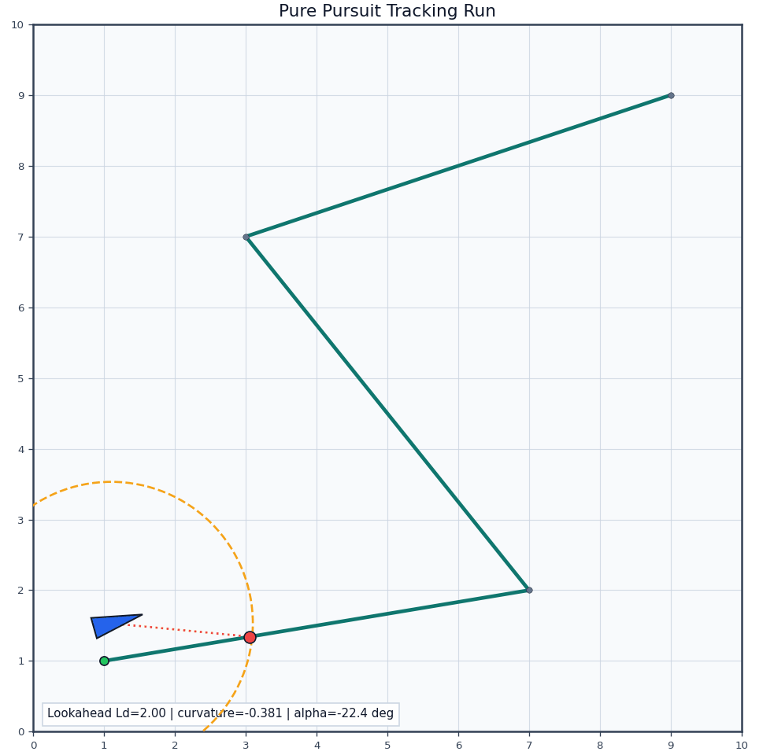 | 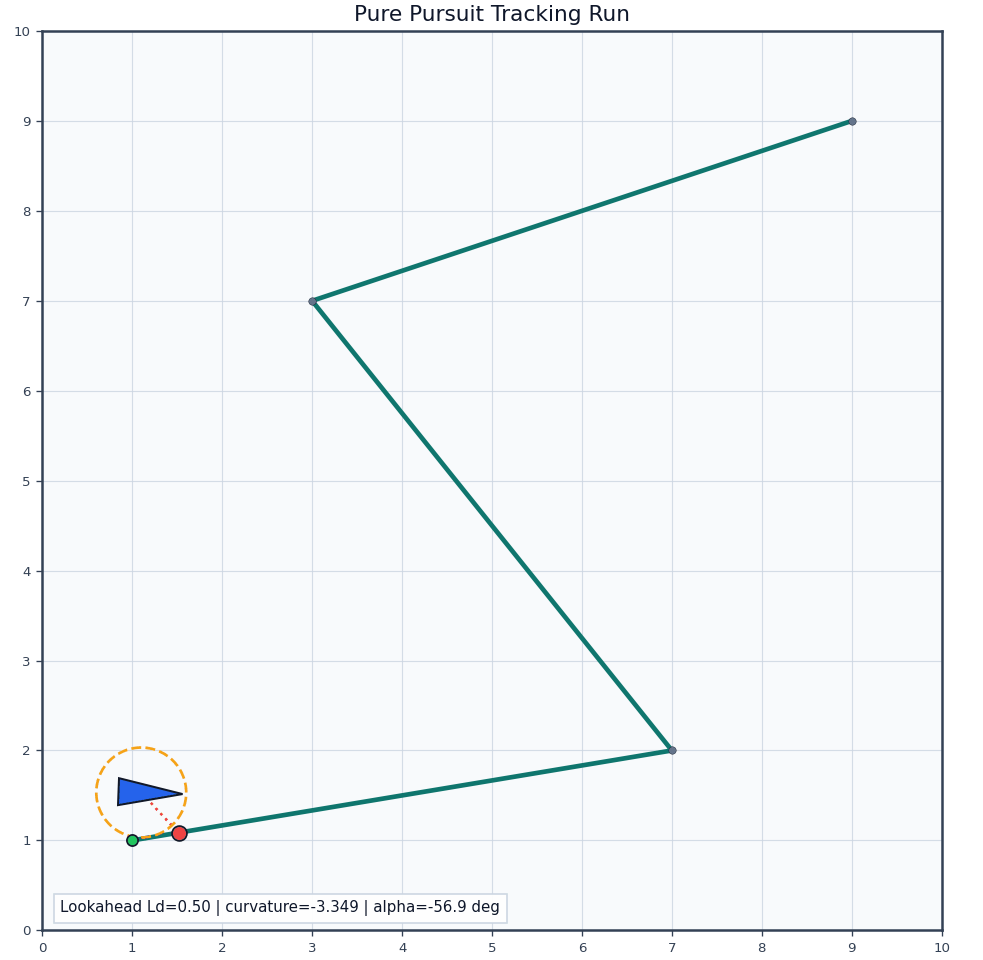 |
| **Longer `L`.** The robot tracks the goal point more slowly, but smoothly. | **Shorter `L`.** The robot tracks the goal point more quickly, but a short enough lookahead distance can cause oscillation and overshoot. |

## 8. Algorithm summary

```text
for each control step:
    1. goal_point   = intersection of (circle of radius L around robot) with the current path segment
                       (or the segment's end point, if already within L of it)
    2. alpha        = angle_between(robot_heading, vector_from_robot_to(goal_point))
    3. kappa        = 2 * sin(alpha) / L
    4. omega        = kappa * v
    5. drive forward at speed v while turning at angular velocity omega for one time step
    6. advance to the next path segment once the current segment's goal point is reached
```

## 9. References

- [Geometric Lateral Control: Pure Pursuit — Coursera, Intro to Self-Driving Cars](https://www.coursera.org/lecture/intro-self-driving-cars/lesson-2-geometric-lateral-control-pure-pursuit-44N7x)
- [Orthogonal Projection Onto a Line — Wikibooks](https://en.wikibooks.org/wiki/Linear_Algebra/Orthogonal_Projection_Onto_a_Line)
- [Circle/line-segment intersection algorithm — Stack Overflow](https://stackoverflow.com/questions/1073336/circle-line-segment-collision-detection-algorithm/1084899#1084899)
- Coulter, R. Craig. *Implementation of the Pure Pursuit Path Tracking Algorithm*. Carnegie Mellon University, Robotics Institute, 1992.

## Image credits

The step-by-step walkthrough diagrams (`images/pure_pursuit_step_01.png` – `pure_pursuit_step_06.png`) were generated with matplotlib by [SamShue/UNCC-ECGR4161-Intro-to-Robotics](https://github.com/SamShue/UNCC-ECGR4161-Intro-to-Robotics) (`diagram_scripts/local_planner/pure_pursuit/pure_pursuit_step_by_step.py`), reused here with permission.

The segment-transition diagrams and lookahead-distance/tracking-run animations (`pure_pursuit_segment_transition_01.png`, `pure_pursuit_segment_transition_02.png`, `pure_pursuit_tracking_run.gif`, `pure_pursuit_lookahead_long.gif`, `pure_pursuit_lookahead_short.gif`) are from the "Pure Pursuit" section of the *ECGR 4161 - Path Planning* course slide deck, reused here with permission.
